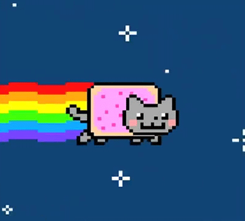

  

# Tela de Login

Interface de login desenvolvida com **HTML e CSS**, como exercício de construção de formulários e estilização de páginas web.

## Prévia

## Recursos
- Campos de usuário e senha
- Botão de entrada
- Link visual para recuperação de senha
- Estilização personalizada em CSS

> **Importante:** este projeto é uma interface estática. O código atual não implementa autenticação, validação no servidor ou recuperação de senha.

## Tecnologias
HTML5 e CSS3.

## Como executar
Clone o repositório e abra o arquivo `tela.html` no navegador. Não é necessário instalar dependências.

## Estrutura
- `tela.html`: marcação da interface
- `style.css`: estilos
- `cat.gif`: recurso visual

## Próximos passos
Adicionar validação de formulário, acessibilidade, responsividade e integração com um backend.

Desenvolvido por **Wellyton Huan** como projeto de estudo.